# PRTG Workflows

Companion to `CAPABILITIES.MD`. That document lists _what_ PRTG can do; this one describes
_how the system behaves over time_ — the loops, lifecycles and state machines that a
PRTG-class monitoring product has to implement correctly.

Every section is written as a sequence we must be able to reproduce. Diagrams are Mermaid.

---

## 1. Operator journey: first hour

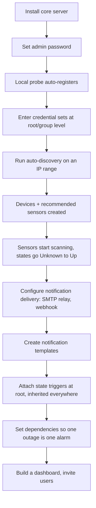

The critical property: **step D before step E**. Credentials are set high in the tree and
inherited, so discovery can identify devices over SNMP/WMI/SSH and create the right sensors.
If credentials come after discovery, the discovery produces ping-only devices and has to be
re-run.

---

## 2. Auto-discovery workflow

Three stages, run against a group (never a single device for the sweep stage):

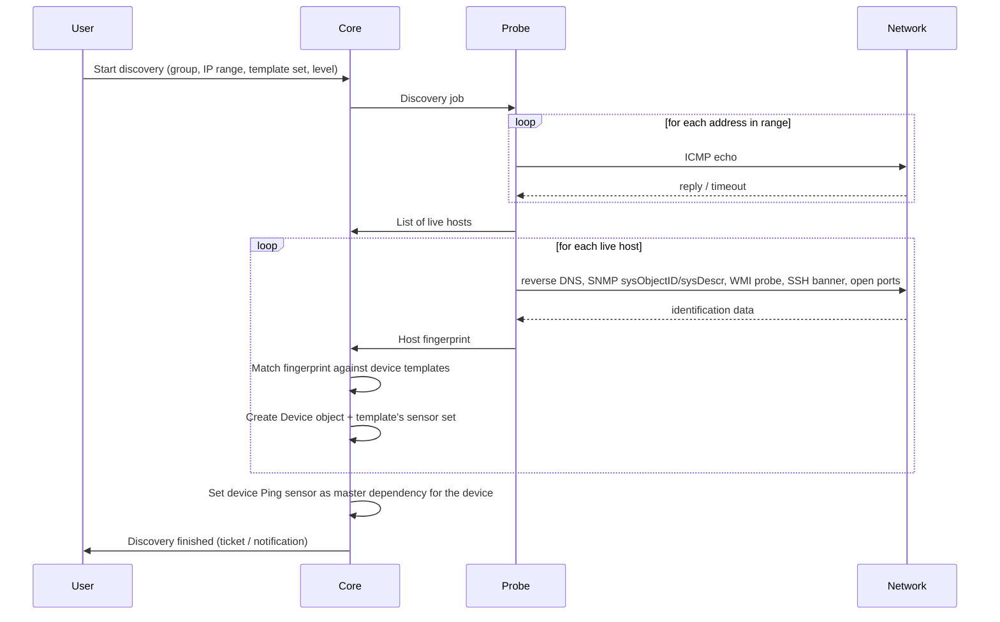

Rules that matter:

- **Idempotency.** Re-running discovery must not duplicate devices or sensors. Match on
  IP/DNS name within the target group; add only sensors that don't already exist.
- **Levels.** From _ping only_ (create the device with a Ping sensor) up to _detailed_
  (attempt every compatible sensor type). Higher levels take much longer.
- **Range size.** PRTG accepts up to 65,536 addresses in one run and warns it may take days.
  Discovery must be resumable, cancellable, and rate-limited so it never starves live checks.
  `D-01` implements all three: the cursor is a column on the core so it survives a probe restart
  and a core failover alike, a cancel is recorded before it is sent so it works while the probe
  is disconnected, and the sweep stands down entirely whenever the probe has a check queued.
  IPv4 only — a sweep enumerates addresses, and the smallest IPv6 subnet anybody assigns is a
  /64.
- **Scheduled rediscovery** (hourly/daily/weekly) may auto-create devices that have appeared
  since. This must be off by default — surprise objects are a support burden. `D-07` is off in
  the strongest sense available: there is no schedule until somebody creates one, a new one is
  created disabled, and auto-provisioning is a *second* flag that is separately off, so the
  default behaviour of an enabled schedule is to sweep, identify and leave the plan for an
  operator to read. A cadence is an **event** — "every Sunday at 03:00" — which is a different
  question from `M-09`'s weekly *window*, so it is its own small thing and a schedule may be
  attached alongside it as a permission window: "weekly, but not during the change freeze".
- **Templates** carry the mapping from fingerprint → sensor set. Users must be able to save
  an existing device's sensor set as a new template.
- Every discovery run produces an auditable summary: hosts scanned, hosts found, devices
  created, sensors created, errors.

---

## 3. The scanning loop

This is the heart of the product. It runs continuously per probe.

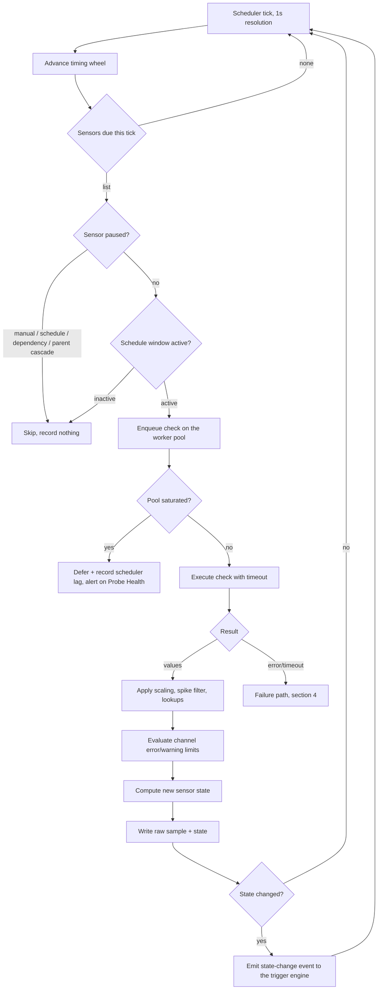

Design constraints:

- **Dispatch precision.** A 60-second sensor must fire every 60 seconds ±1s under full load.
  Per-sensor `setTimeout` does not survive tens of thousands of sensors; a hashed timing wheel
  bucketed by due-second does.
- **Jitter/spreading.** Sensors created together must not all fire on the same second. Offset
  each sensor's phase deterministically by a hash of its ID.
- **Isolation.** A hung SSH or SNMP check must never block the scheduler. Checks run in a
  bounded worker pool; shell-out checks run as child processes.
- **Backpressure.** When the pool saturates, deferred checks are counted and surfaced on
  Probe Health rather than silently queued forever. A check whose next execution is due
  before the previous one finished is skipped, not stacked.
- **Pool size over time.** The pool grows the moment a burst has nowhere to go, waits 200 ms
  before growing for a few stragglers behind a large pool, and gives a worker back after a quiet
  minute. Memory bounds it with hysteresis: growth stops at the reserve and goes past the size it
  held at only with room for two workers above it, workers go back only once memory is a
  worker's worth below it, never in the middle of a check, and each hold is logged once
  (`P-236`, `P-437`).
- **Down means no data.** In PRTG a Down sensor records no channel values. Preserve that:
  the gap is meaningful, and averaging must not interpolate across it.

---

## 4. Sensor state machine

Six states are in v1 scope. **Unusual** (historic baselining) and **Down (Partial)**
(cluster-only) are `[V2]` — the two Unusual transitions below are shown for completeness and
are not built in v1.

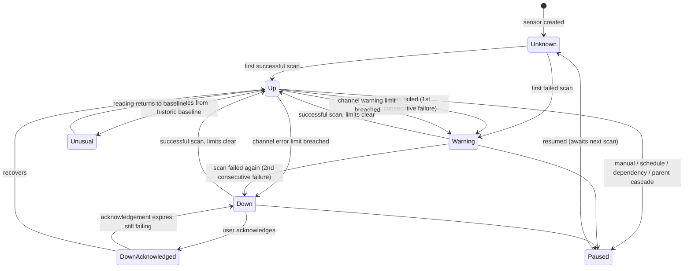

Rules:

1. **Two-step failure** is the default for _query failures only_: first failure → Warning,
   second consecutive failure → Down. Configurable per sensor
   (immediate-down, or warn for N intervals first).
2. **Limit-driven states are immediate.** A channel crossing its error limit sets Down on the
   very first sample; the two-step rule does not apply. Same for lookup-driven states.
3. **Multiple channels.** The sensor's state is the worst state across all its channels, then
   combined with the query-failure state.
4. **Acknowledgement suppresses notifications, not monitoring.** The sensor keeps scanning.
5. **Resume clears acknowledgement.** Pause → resume on an acknowledged sensor returns it to
   plain Down.
6. **Paused is terminal until resumed.** No data, no state change, no notifications. Survives
   a restart of the core.
7. **Every transition is logged** with timestamp, previous state, new state, message, and the
   cause (scan result / limit / lookup / user action / dependency).

---

## 5. Dependency and pause workflow

The purpose is _one outage, one alarm_.

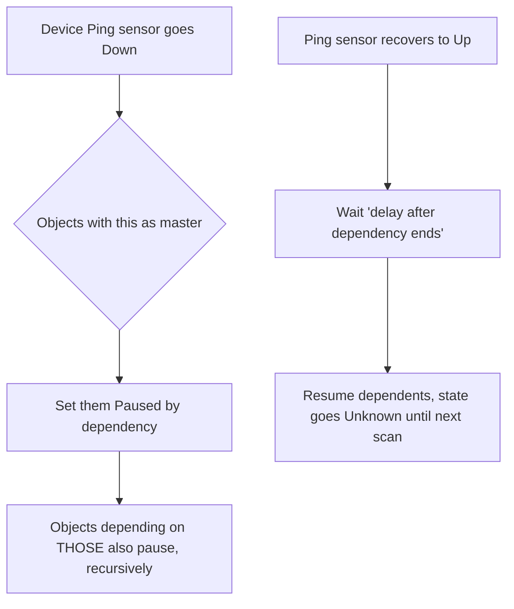

- Auto-discovery sets each device's Ping sensor as **master object for the parent device**,
  so the whole device's sensor set pauses when the device is unreachable.
- Other modes: _use parent_ (inherit the parent's dependency) and _select object_ (point at
  any object in the tree — e.g. every branch-office device depends on the WAN link sensor).
- The master sensor itself must **keep running** while its dependents are paused — otherwise
  nothing detects recovery. (PRTG had a bug here through v19.1.)
- **Only a genuine Down status triggers dependency pausing.** Manually pausing or
  schedule-pausing a master does _not_ pause its dependents via dependency — though the
  ordinary hierarchical cascade (pausing a group pauses its children) still applies.
- The **delay after recovery** exists to stop flapping links from generating alarm storms
  every time they bounce.
- Children paused by cascade cannot be resumed individually; only the object that was directly
  paused can be resumed. The UI must make that legible rather than silently ignoring clicks.

Pause sources, in the order they are evaluated each tick:

1. Parent object paused (hierarchical cascade)
2. Paused by dependency
3. Paused by schedule (inactive window)
4. Paused manually (indefinite, timed preset, or until a datetime)

---

## 6. Notification workflow

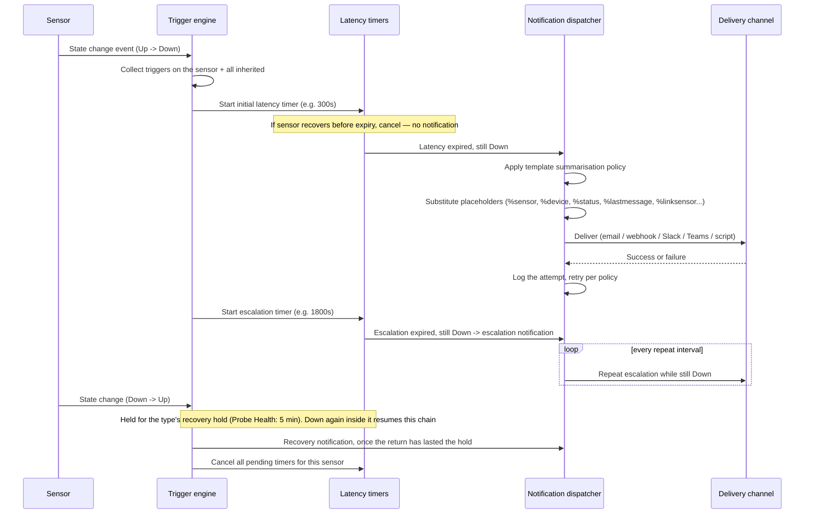

Behaviours that must be right:

- **Latency prevents false alarms.** A 30-second blip on a sensor with a 5-minute initial
  latency produces no notification at all.
- **Acknowledgement stops the chain.** Acknowledging a Down alarm cancels pending escalations
  and repeats; the recovery notification still fires when it comes back.
- **A relapse is the same outage** (`M-18`). A return to Up is held for the sensor type's
  recovery hold before the alarm is over, and a Down inside the hold resumes the chain where it
  stopped: no second initial notification, and the escalation still measured from the outage's
  start. Only Probe Health has a hold, five minutes, because a probe killed and restarted
  connects for seconds a round and would otherwise page at every kill. A trigger can set its own
  `recoveryHoldSeconds`. The cost is that the recovery notification waits out the hold.
- **Trigger inheritance.** A state trigger set on the root applies to every sensor. A sensor's
  trigger tab shows own + inherited triggers, with the source object named.
- **Summarisation** batches storms. Default policy is _first down and up immediately, then
  summarise_: the first event of a storm goes out at once, the rest are collected into a
  digest. Cap the digest (PRTG uses ~1000 characters / 25 events, splitting overflow into
  additional messages, which go in order: once a part is refused, the later parts wait for
  its retry rather than going ahead of it). **A recovery is never told before its alarm** (`N-20`): one whose alarm
  is still held joins the same digest, listed after it, and one whose alarm is held for another
  template's digest waits for that digest to go. One whose alarm went at once and is waiting out
  a delivery retry waits for that retry (`N-21`), and goes on its own if the alarm is given up on.
  A new alarm waits for the last outage's recovery only on its own template, and is never made
  late by it. It waits out that recovery's retry, which uses the same transport. It joins that
  recovery's digest, and if the mode sends the alarm at once, the digest goes now and ends on the
  alarm. A recovery still owed when a newer alarm of its trigger has been delivered is not sent
  at all (`N-22`): its recipients' last word stays the alarm before it, which is true again, and
  the next outage's own recovery tells them when that one is over. It is kept while a newer alarm
  of its own template is still waiting behind it, so those recipients hear Down, Up, Down.
  One that had taken its window's single immediate Up gives it back when it is dropped, while
  that window is open (`N-26`): it sent nothing, so the next Up in the window goes at once as the
  first would have. An Up already held in the same pass stays in the digest.
  **A trigger's alarms go in the order they were queued** (`N-23`): initial, escalation, repeat,
  per template. One waits while an earlier alarm of its trigger on its own template is undecided,
  retrying or claimed, and joins that one's digest when it is held in one, flushing it when its
  mode sends it at once. Never across templates, and never for a deleted trigger.
- **Immediate-only channels.** Slack, Teams, HTTP action, script execution and ticket
  assignment are never summarised — they are cheap and often machine-consumed.
- **Template schedules.** A template can be active only during business hours, with a choice
  between queueing suppressed notifications for later delivery and discarding them.
- **Delivery failure is itself an alarm.** A dead SMTP relay must surface on Core Health, not
  disappear into a log file. Paessler's own advice is to configure two notifications with
  different delivery methods per trigger.
- **Test send.** Every template needs a "send test notification" action, and every sensor a
  "simulate error state" action, so operators can validate a chain end to end without
  breaking something real.

---

## 7. Alarm handling workflow (operator's day)

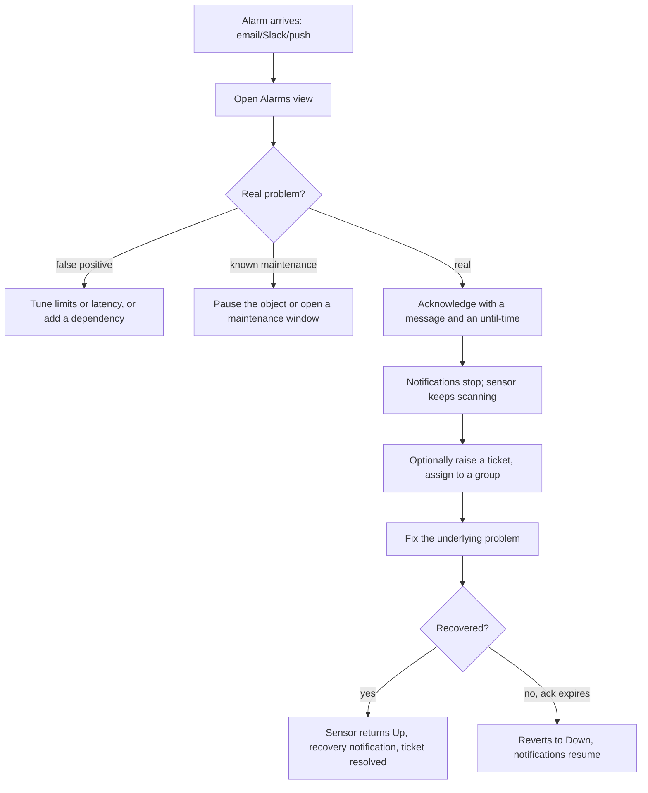

The Alarms view is the operator's home screen: every sensor in Down, Down (Partial),
Down (Acknowledged), Warning or Unusual, filterable to errors only / warnings only, scoped
globally or to one branch of the tree, sorted by priority then duration.

A sensor that is back while its alarm waits out a recovery hold (`M-18`, §6) is listed too, as
Recovering, below everything still happening. The row says when the alarm is over if the
sensor does not fail again, and leaves the list at that moment. A relapse puts it back in the
list's main part as the same alarm.

---

## 8. Maintenance workflow

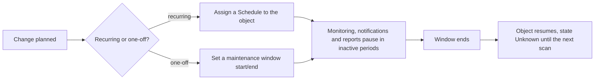

- Schedules are **reusable named objects**, authored either as a weekday × hour grid or as a
  period list (`fr:19:30-mo:06:05 we:18:45-we:23:00`). A period list says explicitly which of
  the two it describes: the times monitoring runs, or the times it is suspended. Both are
  things operators write — "office hours" is naturally the first, "the weekend change freeze"
  the second — and storing which one was meant is what stops an editor silently inverting
  somebody's schedule. Grid cells always mark the monitored hours.
- A schedule suppresses **monitoring, notifications and reports** — not just alerting.
- A schedule assignment is an **inheritable setting** like any other: set it on a group and
  everything beneath it follows, override it on a device, or set it to none so one device inside
  a scheduled group is always watched.
- A maintenance window is the one-off equivalent, with explicit start and end datetimes. It is a
  manual pause that has not started yet — same object, same cascade, same resume — so nothing is
  paused until it begins, and it is called off at any point by resuming the object it is on.
- Schedules and dependencies are independent mechanisms and do not override each other.
- Downtime inside a maintenance window should be excluded from uptime/SLA reporting — this is
  a frequent complaint about tools that get it wrong.

---

## 9. Data lifecycle

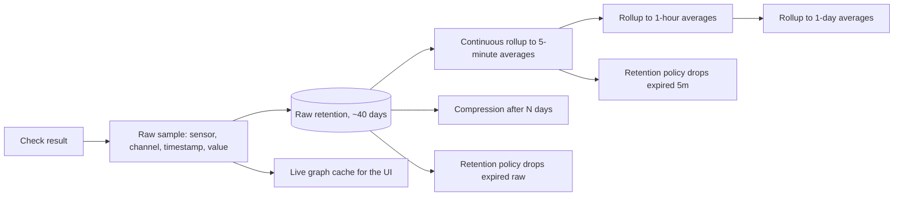

- **Raw** data answers "what happened in the last few days" at full fidelity.
- **Rollups** answer "what happened last quarter" without scanning billions of rows. PRTG
  enforces this by refusing sub-hourly detail on ranges longer than 40 days.
- **Query rules to reproduce:** ranges >500 days are rejected and shortened to 365; ranges of
  40–500 days force ≥60-minute averaging. The API should pick the coarsest rollup that still
  satisfies the requested resolution.
- **Gaps are not zeros.** Down periods and paused periods produce no samples; averaging must
  distinguish "no data" from "value 0", and graphs must render a break, not a line to zero.
- **Downtime accounting** is computed from state history, not from sample values, so it stays
  correct across rollups.
- Housekeeping runs as a scheduled job with per-class retention: raw samples, rollups, logs,
  state history, audit records, reports, and generated files each get their own policy.

---

## 10. Distributed probe workflow

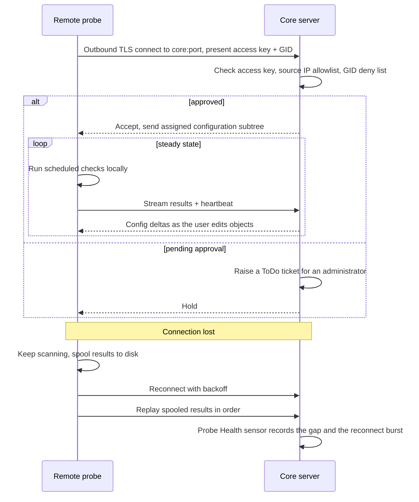

Key properties:

- **The probe dials out.** No inbound firewall rule at the remote site. This is why PRTG's
  model works in customer networks and why we copy it.
- **Approval is explicit.** A new probe arrives pending; an administrator approves it. Access
  keys, an IP allowlist and per-GID revocation are the controls.
- **A decision reaches the probe that is already connected.** Approving one closes its link so it
  comes straight back with a key and a subtree (`P-189`); withdrawing trust — revoking it,
  deleting it, or narrowing an address filter past where it sits — closes the link _and says
  why_, so it drops its assignments and scans nothing. The reason has to travel: disconnect
  tolerance below means a probe that merely loses the core keeps checking and spools, so a bare
  close would leave a machine somebody just refused still probing their network. A version skew
  or a key out of step is not that — nobody has said the machine must stop, so it keeps checking
  and spooling while an operator fixes one end. Narrowing a filter that still covers the probe
  costs nothing: tightening a range around the machines already inside it must never be an outage.
- **Disconnect tolerance.** PRTG buffers up to 500,000 results _in RAM_, losing them if the
  probe restarts. We spool to disk instead, with a bounded size and oldest-first eviction —
  and we count what we drop.
- **Replay must not stampede the core.** Rate-limit the catch-up stream so a reconnecting
  probe with hours of backlog doesn't take down ingestion for everyone.
- **Config push is incremental.** The probe holds only its own subtree, and edits arrive as
  deltas.
- Probes are the natural place for local-network-only checks: WMI/PowerShell on Windows,
  syslog and flow receivers close to the source, SSH into an isolated segment.

---

## 11. Reporting workflow

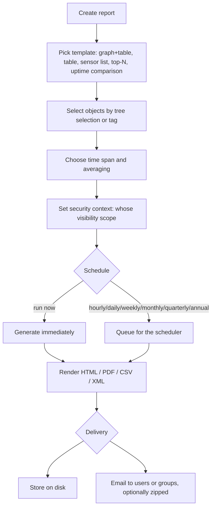

The security context matters: a scheduled report must render only objects the named user is
allowed to see, otherwise reports become a permission-bypass channel.

---

## 12. Administration workflows

**Adding a user**

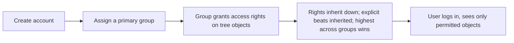

Access-right levels are none / read / write / full. Write adds editing, object creation and
deletion, alarm acknowledgement and notification management; full adds the ability to edit
that object's group rights. Read-only accounts are restricted at the account level regardless
of group — they cannot see stored credentials.

**Credential management**: credential sets (SNMP, Windows, SSH, VMware, database) are defined
on a group or device and inherited by every sensor beneath. Changing a password in one place
updates hundreds of sensors. Secrets are write-only through the API and encrypted at rest.

**Configuration change auditing**: every object create/update/delete is recorded with user,
timestamp and a diff, visible on the object's history tab.

**Upgrade**: stop service → back up config and database → migrate schema → start → verify
Core Health and probe reconnection → verify a sample of sensors resumed.

---

## 13. Failure workflows (what the system does when it breaks)

| Failure                     | Expected behaviour                                                                                            |
| --------------------------- | ------------------------------------------------------------------------------------------------------------- |
| Core server restarts        | Paused states persist; sensors resume on their next due tick; probes reconnect and replay their spools. A probe that has not reconnected is marked lost, and its Probe Health read, only once the 120 s delivery grace has run out, the same grace for both, so a restart pages nobody for a probe that redials inside it. The price is that a probe genuinely dead at boot is named that much later (`P-110`, `M-22`) |
| Database unavailable        | Checks continue, results spool locally, ingestion resumes on recovery; Core Health goes Down                  |
| Probe unreachable           | Probe Health goes Down; its sensors go Unknown (not Down — we don't know); a single alarm, not one per sensor, for every trigger that covers Probe Health. A trigger that cannot see it, or a probe with none, still hears per sensor rather than nothing (`M-22`) |
| Probe connected but sending no results | Same answer, and it has to be: the sensors are equally unasked. Detected from *arrival* times, never the probe's own timestamps, so a spool replay cannot trip it (`P-74`) |
| Notification delivery fails | Logged, retried with backoff, surfaced on Core Health; the alarm itself is not lost                           |
| A check type hangs          | Killed at timeout; the worker is recycled; scheduler unaffected                                               |
| Scheduler falls behind      | Lag metric rises, deferred-check counter increments, Probe Health warns before anything is silently dropped   |
| Disk fills                  | Housekeeping escalates, oldest raw data is evicted first, a critical alarm fires before ingestion stops       |
| Clock jumps                 | Timing wheel resynchronises against monotonic time; samples keep wall-clock timestamps                        |
| A probe's clock is wrong    | A result no clock could have stamped, more than 15 minutes ahead of the core or older than anything is kept, is refused whole, readings and state together. Counted on that probe's Probe Health, which warns, and logged once a batch (`P-99`, `P-231`). Never moved to a time nobody measured it. A clock that steps back leaves each sensor whose last result is later than the clock now reads Unknown, as a lost probe's sensors are, until it catches up; the probe's offset and the frozen count are on its Probe Health (`P-232`) |
| A probe reports on work it was not given | Refused where it arrives, and nothing is written: a result for a sensor not under it (an `error` one included, so no sensor turns Down on another probe's word), an answer to a query put to another probe, a message about another probe's discovery run. Acknowledged all the same, so the probe does not resend it. Counted on that probe's Probe Health, which warns only for work it never had: a sensor moved away from it or deleted while its spool still held results is the probe lagging a change, and is counted without a warning (`P-228`) |

The last column is the actual specification. A monitoring system that fails silently is worse
than none, because it is trusted.
